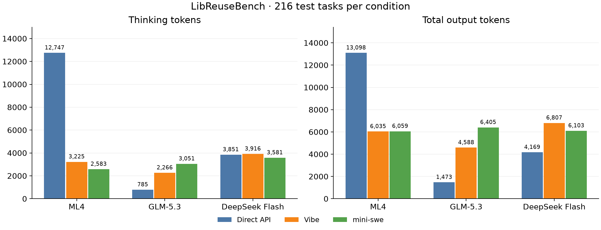
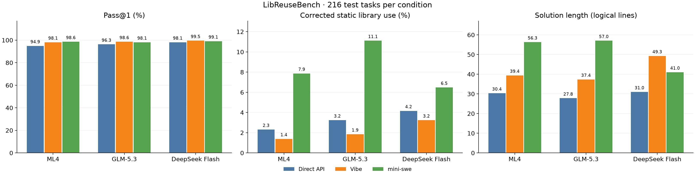

# ML4, GLM-5.3 and DeepSeek Flash on LibReuseBench

These saved runs compare direct API calls, Mistral Vibe and mini-swe-agent on all
**216 LibReuseBench test tasks**: **1,944 scored submissions**, one per task and
condition. Runs completed on 20–21 November 2026. Harness execution and grading
used **SKO CPU jobs**; the API's inference hardware/location was not exposed.
The 252 historical ML4 control submissions are archived separately.

**Observed:** ML4 uses substantially more thinking in the direct API condition.
Its mean total output falls from 13,098 tokens to 6,035 with Vibe and 6,059 with
mini-swe. This pattern is not shared by GLM or DeepSeek on this benchmark: their
agent conditions use more total output than their direct calls. All conditions
have high correctness, ranging from 205/216 to 215/216 passes.

**Observed:** mini-swe includes library paths more often than Vibe, but most
library-containing agent solutions retain handwritten logic. This helps explain
why more library use does not necessarily mean shorter solutions. These are
observations about these model/harness configurations, not isolated prompt effects.

## Results



[Token-chart PDF](charts/tokens.pdf) · [All result tables](RESULTS.md) ·
[CSV](summary.csv) · [JSON](summary.json)



[Outcome-chart PDF](charts/outcomes.pdf)

The main tables show pass@1, mean thinking/output tokens, imported/used library
counts, high-reuse tasks and mean solution length. They retain **all 216 attempts**
per condition, including failures. ML4 and GLM mini-swe each have one official
failure because the evaluator could not install `backports`; these are included.
LLOC means cover measurable submitted code, including failing solutions:
213/215/214 direct submissions for ML4/GLM/DeepSeek, and 216 for each agent condition.

Output means use provider-reported completion usage, including thinking, visible
text and tool arguments, summed across calls. They are not the length of the final
solution. API attempts include retries/rate-limit responses, particularly for GLM;
an attempt without usage is not necessarily a generated completion. Missing usage
from partial/deadline calls is not estimated. The tables report call coverage.
Provider tokenizers and reasoning semantics can differ, and token counts do not
establish latency or cost comparisons.

## Protocol

| Setting | Value |
|---|---|
| Models requested | `mistral/mistral-large-4`, `mistral/zai-glm-5-3`, `mistral/deepseek-v4-1-flash-1017` |
| Model identity | API aliases; immutable checkpoints were not exposed. “ML4” here is the API model, not a named local checkpoint. |
| Dataset | Official `libreusebench==0.3.1` distribution; 216 test and 84 control tasks. HF revision and split/wheel hashes are in `protocol/experiment.json`. |
| Direct API | One request with the original task text, no system message, no tools or execution feedback. Transport recovery is not a new scored sample. |
| Vibe | `mistral-vibe==3.1.3`, native headless CLI and stock prompts/tools |
| mini-swe | `mini-swe-agent==2.4.6`, released `DefaultAgent`/`LitellmModel` and stock tool-calling template |
| Requested sampling | High reasoning effort, temperature 1.0, top-p 0.95, 32,768 output tokens per call |
| Agent budget | 50 turns, 30 minutes per task; subagents disabled |
| Vibe context | 1,048,576 tokens, compaction threshold 400,000; configured limits, not evidence that compaction occurred |
| Grading | Official Python 3.12 function evaluator, 30-second test timeout and 4 GiB subprocess address-space cap |
| Execution | SKO CPU harness/grader jobs; API inference location unknown |
| Agent environment | Isolated per-task workspaces, installed third-party packages, internet access; no supplied hidden tests, reference solutions or grader feedback |

Both agents received the same wrapper asking for `/workspace/solution.py`:

> Implement the function requested below in /workspace/solution.py. That file is
> your submission and must be self-contained; other files are not included. You
> may inspect the environment and write and run your own tests.

The final saved file at termination was submitted once. Missing files, invalid
code, time/turn limits and model failures were retained under the evaluator's
ordinary scoring rules. There were no correctness-driven whole-task retries.
Setup attempts that made no model call and synthetic startup probes are not
additional benchmark samples. ML4's completed runs were reused when adding the
other models; all nine conditions use the same 216 task IDs.

Exact first-request system messages, tool schemas and task-template text are in
[agent_prompts_and_tools.json](protocol/agent_prompts_and_tools.json). Only the
task text is replaced with `{task_prompt}`. Within each harness, system messages
match across models. GLM/DeepSeek Vibe's `read_file` description omits an
image-return sentence present for ML4; this difference is retained and recorded.
Cross-model upstream requests streamed, with assembled responses for mini-swe's
native nonstreaming client. Direct-call seeds are saved where available; native
agent calls were unseeded. Different serving dates may conceal alias changes.

Prompt/tool text is attributed to [Mistral Vibe](https://github.com/mistralai/mistral-vibe)
and [mini-swe-agent](https://github.com/SWE-agent/mini-swe-agent), at the package
versions above; their distributed licenses are retained under `protocol/licenses/`.

The reference-package inventory and actual grader versions are included. NLTK's
`punkt_tab` resource was prepared after three reference-validation failures, and
those reference cases were rechecked; no benchmark task or test was changed.

## Corrected static library-use metric

The original `lure==0.3.1` visitor could let `except ImportError: np = None`
overwrite a successful `import numpy as np` binding before inspecting a later
reference. The local `0.3.1+branchfix1` correction increased test submissions
marked used from **61 to 90**. **32 library sets** changed across the saved
submissions; adding another library does not always change the used/not-used flag.
Imports, correctness, code lengths and tokens were unchanged.

Both original and corrected library sets are retained per submission. Corrected
sets were also reproduced for **all 2,196 submissions** using
[PR #3](https://github.com/itsluketwist/library-reuse-rl/pull/3), commit
`068bac00bb7479f60a5251c293307c9df4ada2fc`. This result contribution does not modify
the analyzer or silently replace old repository result files.

“Imported” is the presence of a third-party import. “Used” is a static reference
to a possible imported binding. It does **not** establish that the path runs on a
test or that the principal algorithm was delegated to the library. In these
submissions the corrected imported/used program counts coincide, but an arbitrary
unused import still earns no usage credit. The high-reuse subset has 52 tasks
whose reference library solution saves at least 15 logical lines.

## Source review and runtime audit

These are supplementary measurements, not replacements for the benchmark fields.
All 90 import-containing test submissions were instrumented and replayed on
1,022 saved inputs; instrumented outputs matched the expected outputs. A source
scan of all 1,944 test submissions found no dynamic third-party imports bypassing
the import-containing selection.

| Audit result | Count |
|---|---:|
| Principal operation delegated, no handwritten replacement/fallback, and a successful library call observed | 26 |
| Mixed/partial implementation with a library call observed | 50 |
| No library call observed on the saved tests | 14 |

The strict “library-only” category allows ordinary input preparation, validation,
formatting and fit-scoring arithmetic. It excludes manual algorithms using NumPy
primitives, preprocessing-only reuse, test-only imports and compatibility-only
imports. It is a manual criterion, not a general quality ranking. Borderline
DeepSeek mini-swe T160 uses NumPy histogramming but writes the separately requested
Gaussian-PDF formula; counting that formula as glue would raise the retained count
from 26 to 27. Per-solution reasons and observations are included under `audit/`.

**61/90 (67.8%)** benchmark-used solutions contain substantial handwritten or
partial implementations. Conditional on a library being present, Vibe and
mini-swe are similar: **11/14 (78.6%)** versus **45/55 (81.8%)**. Mini-swe adds a
library path more often overall: **55/648**, compared with Vibe's **14/648**.

**15 programs / 15 library–program pairs** contain an inactive import on the saved
tests: 12 import branches are not reached, and three modules are imported without
a library call. Fourteen programs call no third-party library at all. The extra
program, GLM mini-swe T002, uses scikit-learn but does not reach its NumPy import.
These packages still have static references and are marked imported/used by the
benchmark. This does not prove that their code is globally unreachable.

Concrete examples (complete submitted code is linked):

- **Longer code despite reuse:** GLM T062 uses a 9-LLOC
  [Vibe PyYAML solution](examples/glm53_vibe_LRB_T062.md), versus a 183-LLOC
  [mini-swe solution](examples/glm53_mini_swe_LRB_T062.md) with a handwritten YAML
  fallback. Both pass.
- **Two implementations:** [ML4 mini-swe T163](examples/ml4_mini_swe_LRB_T163.md)
  joins matched IDs into 2D points and clusters them with k=2. It runs handwritten
  Lloyd iterations and scikit-learn `KMeans`, compares inertia, and chooses labels.
- **An inactive fallback:** [DeepSeek mini-swe T166](examples/deepseek_flash_mini_swe_LRB_T166.md)
  first solves ordinary least squares with Fraction-based Gaussian elimination;
  its NumPy least-squares fallback is unused on all 11 tests, although NumPy imports.
- **Analyzer false negatives:** [ML4 Vibe T062](examples/ml4_vibe_LRB_T062.md)
  references `yaml.safe_load`, and [ML4 mini-swe T003](examples/ml4_mini_swe_LRB_T003.md)
  references `Levenshtein.ratio`, after optional imports. The original analyzer
  missed those possible library bindings.

## Prompt observations and thinking patterns

Mini-swe's stock **user/task template**, rather than its short system message,
includes this example in all 648 test prompts:

```python
import numpy as np
hello = "world"
print(hello)
```

Vibe's 648 prompts have no such example. Mini-swe solutions import NumPy 40 times,
versus nine for Vibe. DeepSeek mini-swe T166 explicitly cites the example as
evidence that NumPy is acceptable. Some Vibe traces interpret “self-contained” as
dependency-free even though the packages are installed. These observations
suggest prompt/workflow effects; neither clause has been isolated in an ablation.
There is no blanket Vibe rule forbidding third-party libraries. Optional
acceleration and compatibility fallbacks are also ordinary engineering patterns.

“Repeated intent to answer” flags a task if one thinking response contains at
least five paragraph-opening drafting/finalization cues and at least 1,000 words.
It occurs in **94/216 ML4 direct** tasks, **1/216 GLM Vibe** tasks and
**3/216 DeepSeek direct** tasks; other conditions have none. Exact repeated-word
shares use normalized, non-overlapping earlier 20-word sequences within each
response, pooling repeated/total word counts. ML4 direct's share is 4.20%, versus
0.30% with Vibe and 0.06% with mini-swe. See the complete table and
[methodology](protocol/repetition_methodology.json).

For example, [ML4 direct T179](audit/repeated_intent_example.json) used 17,496
thinking tokens and contained ten such cues, repeatedly returning to phrases
such as “Now, final answer” and “Now, final answer can include code only” before
eventually submitting. The linked file preserves the first eight matching excerpts.

The analysis excludes request history, visible answers and tool arguments from
thinking-text repetition. Repetition heuristics are not semantic judgments about
whether reasoning is useful. No finite capped trace proves infinite generation.
Full multi-turn transcripts are not included: token and repetition statistics are
frozen telemetry, while the submitted answers/code are included in full.

## Files and regeneration

| File | Contents |
|---|---|
| `submissions.jsonl` | All 1,944 test records: submitted answer, extracted code, frozen correctness, original/corrected libraries, code metrics, usage and repetition counts |
| `ml4_controls.jsonl` | All 252 historical ML4 control records, kept outside the main comparison |
| `summary.json`, `summary.csv`, `RESULTS.md` | Regenerated summaries with explicit denominators |
| `protocol/` | Resolved settings, prompt/tool snapshots, package versions and repetition definitions |
| `audit/` | Ninety source classifications/runtime observations and the inactive-import list |
| `provenance.json`, `SHA256SUMS` | Original source-artifact hashes and hashes of this exported bundle |
| `examples/`, `charts/` | Readable code examples and standalone PNG/PDF figures |

From this directory, validate records and compare the generated tables with the
committed versions using only the standard library (Python 3.10+):

```bash
python summarize.py
sha256sum --check SHA256SUMS
```

To rebuild tables and charts:

```bash
python -m pip install 'matplotlib>=3.7'
python summarize.py --write --plots
```

To independently recompute corrected static imports/usage from every submitted
program, install the pinned fix in an isolated environment and run:

```bash
python -m pip install 'lure @ git+https://github.com/jie-m-zhang/library-reuse-rl.git@068bac00bb7479f60a5251c293307c9df4ada2fc#subdirectory=reward'
python summarize.py --verify-static
```

Regeneration does not execute submissions, call a model, rerun correctness tests
or reproduce the manual/runtime audit. It reaggregates the frozen observations;
the static check reparses the included code. Original correctness outcomes and
failure reasons are retained, rather than replaced by diagnostic rescoring.
Examples are rendered copies; byte-preserving source strings and their SHA-256
hashes are in the JSONL records. Plot rendering may vary by Matplotlib version;
the committed plots used 3.11.2. Regenerating artifacts can change their hashes.

Limitations: one sample per task/condition, API aliases without immutable
checkpoints, different provider tokenizers/serving dates, partial-call telemetry,
internet-enabled agent runs, and judgment in the strict source filter. Harness
comparisons also change system prompts, tools, wrappers and execution feedback.
The results do not isolate system-prompt causality or establish a universal model
or harness ranking. This contribution contains only LibReuseBench experiments.
