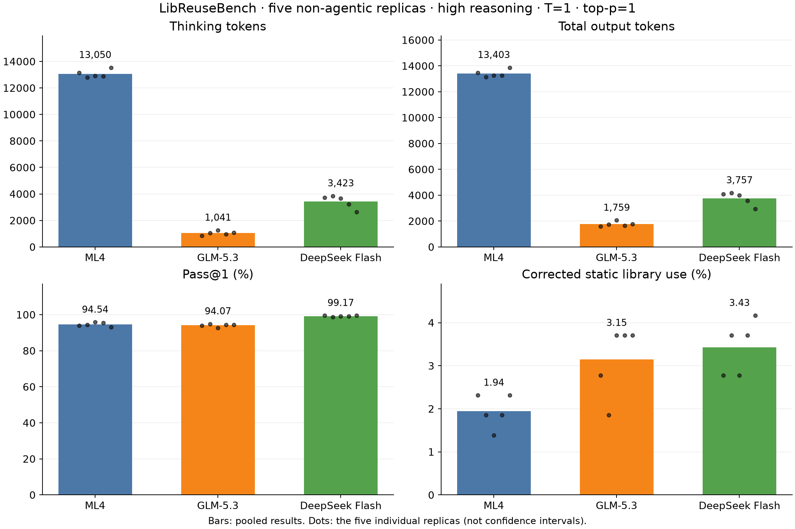

# Five non-agentic LibReuseBench replicas: ML4, GLM-5.3 and DeepSeek Flash

All **3,240 submissions** are scored: 216 test tasks × five independent samples ×
three API models. Generation and grading completed on **25 November 2026** using
**SKO CPU jobs**. Model inference hardware/location and immutable checkpoint IDs
were not exposed by the API.

| Model | Passes in replicas 1–5 (each /216) | Pooled pass@1 | Mean thinking tokens | Mean output tokens | Corrected static library use |
|---|---|---:|---:|---:|---:|
| ML4 | 203, 204, 207, 206, 201 | 94.54% (1,021/1,080) | 13,050 | 13,403 | 21/1,080 (1.94%) |
| GLM-5.3 | 203, 205, 200, 204, 204 | 94.07% (1,016/1,080) | 1,041 | 1,759 | 34/1,080 (3.15%) |
| DeepSeek Flash | 215, 213, 214, 214, 215 | 99.17% (1,071/1,080) | 3,423 | 3,757 | 37/1,080 (3.43%) |

ML4 used about 7.6 times GLM's output tokens and 3.6 times DeepSeek's in this
cohort. Its observed pass@1 is close to GLM's and below DeepSeek's. This is a
comparison of the recorded configurations, not a universal model ranking.

[Complete tables](RESULTS.md) · [Model CSV](final_models.csv) ·
[Replica CSV](final_replicas.csv) · [Machine-readable summary](summary.json)



[Chart PDF](charts/comparison.pdf). Bars show pooled results; dots show individual
replicas, not confidence intervals.

## Raw generations and analysis

The export uses the repository's paired-file layout: **15 `.json` analysis files
with 15 corresponding `.generations.jsonl` files**, one pair per model/replica.
Each JSONL line contains the **full accepted response, including thinking**, its
saved correctness/library/code metrics, stop reason and reported completion tokens.
The files are split by replica; the largest generation file is about 12 MB.

| Model | Replica files | Pooled native analysis |
|---|---|---|
| ML4 | [1](raw/ml4/replica_1/) · [2](raw/ml4/replica_2/) · [3](raw/ml4/replica_3/) · [4](raw/ml4/replica_4/) · [5](raw/ml4/replica_5/) | [pooled.json](raw/ml4/pooled.json) |
| GLM-5.3 | [1](raw/glm53/replica_1/) · [2](raw/glm53/replica_2/) · [3](raw/glm53/replica_3/) · [4](raw/glm53/replica_4/) · [5](raw/glm53/replica_5/) | [pooled.json](raw/glm53/pooled.json) |
| DeepSeek Flash | [1](raw/deepseek_flash/replica_1/) · [2](raw/deepseek_flash/replica_2/) · [3](raw/deepseek_flash/replica_3/) · [4](raw/deepseek_flash/replica_4/) · [5](raw/deepseek_flash/replica_5/) | [pooled.json](raw/deepseek_flash/pooled.json) |

[files.json](files.json) enumerates every pair. Filenames follow
`libreusebench_test-high_t1_p1_32k-base.json` and
`libreusebench_test-high_t1_p1_32k-base.generations.jsonl` within each replica folder.

These are **schema-adapted exports of a streaming-runner campaign**, rather than
files originally emitted by `run_eval.py`. The per-response grading fields and
native scorer aggregates are retained. The top-level `metadata`/`analysis` layout
and generation fields follow `src/eval/evaluate.py` and
`src/eval/scoring/libreusebench.py`. No model generation or correctness regrading
was performed to publish this export.

`response` combines the exact accepted reasoning and answer as
`<think>…</think>…`, matching the repository API client's assembly. The added
`submitted_answer` field preserves the exact text originally graded. For all
3,240 records, adding the thinking block selects the same code and reproduces the
same static import/use sets. Hashes cover the full response, submitted answer,
reasoning, selected code and original source artifacts.

Within a single-replica file, native `idx` is 0 and `replica` is 1–5. The source
runner numbered replicas 0–4; the export maps those to 1–5 explicitly. Model-level
`pooled.json` files list their five generation files and preserve the native
five-sample analysis. `task_metrics.jsonl` is a compact index for reading numerical
results without loading the thinking text.

Connection metadata, credentials, local execution paths, HTTP/SSE framing and
partial retry prefixes are omitted. Native environment package/version records
are preserved, with the local directory removed. Original source-file hashes
remain in [provenance.json](provenance.json). This bundle contains every accepted
sample; unsuccessful transport attempts are not extra replicas.

## Protocol

| Setting | Value |
|---|---|
| ML4 requested alias | `mistral/mistral-large-4` |
| GLM requested alias | `mistral/zai-glm-5-3` |
| DeepSeek requested alias | `mistral/deepseek-v4-1-flash-1017` |
| Benchmark | Official LibReuseBench 0.3.1 test split, all 216 tasks |
| Prompt | Repository `base` style: original task text, no system message, suffix, tools or execution feedback |
| Reasoning effort | Explicit `high` for all models |
| Sampling | Explicit temperature 1.0 and top-p 1.0 |
| Output limit | 32,768 tokens per request, including thinking |
| Samples | Five independent requests per task/model; one completion per request; no seed sent |
| Generation order | Replicas interleaved by task; three T035 API pilot completions retained once in replica 1 |
| Recovery | At most six transport attempts per sample; completed capped/empty answers are retained without correctness-driven retries |
| API concurrency | ML4 8; GLM 4; DeepSeek 4 |
| Grading | Official function evaluator, Python 3.12.3, 30-second verifier timeout, 4 GiB subprocess address-space limit |
| Execution | SKO CPU clients/grading, no locally allocated inference GPUs; API inference location unknown |
| Pinned source | `77b898c96d54e1ea65c1ea7a5e88061820f6fac7`, including merged analyzer fix [#3](https://github.com/itsluketwist/library-reuse-rl/pull/3) |

The exact request shape, dataset SHA-256, model aliases and remaining settings are
in [protocol.json](protocol.json). `top_k=0` in the native-style metadata means
disabled; no `top_k` parameter was transmitted. The package version is still
`lure==0.3.1`, so **the source commit matters**: the published 0.3.1 package predates
the merged branch-state fix.

The 32,768-token cap preserves the earlier comparison's cap; it is an explicit
override of the repository's 8,192/16,384-token decoding profiles. These are fresh
top-p 1.0 runs. No samples from the earlier
[top-p 0.95 agent/direct comparison](../api-harness-comparison-20261120/README.md)
are reused, and no controls or agent runs are included in this cohort. Serving
dates, sampling and sample counts differ from that earlier campaign; changes
between campaigns do not isolate the effect of top-p.

Generation used a resumable streaming adapter and the pinned repository's original
task text. The official evaluator then scored each replica independently in a
credential-free container. Its environment used previously validated reference
packages and NLTK resources; additional imports went through the evaluator's
ordinary installation workflow. Six reference solutions passed the preflight.
Resolved package versions are recorded per replica, including installation failures.

## Metric definitions and limits

- **Pass@1:** passes across all five replicas divided by 1,080 attempts per model.
  Individual replica results each use 216 attempts. The scorer's floating-point
  average of task fractions agrees with these counts within rounding precision.
- **Pass@5:** fraction of the 216 tasks passed by at least one of their five
  samples. It is 214/216 for ML4 and GLM, and 215/216 for DeepSeek.
- **Output tokens:** provider-reported completion tokens of the accepted response,
  including thinking and visible answer. Every accepted sample has usage. Tokens
  emitted by incomplete retries are outside these means; provider tokenizers and
  reasoning semantics can differ.
- **Library use:** corrected static references to imported third-party bindings.
  Counts are per response. They do not establish executed calls or removal of
  handwritten fallback implementations. The previous campaign's manual/runtime
  audit was not repeated here.
- **Solution length:** logical lines of code in measurable submitted programs,
  including failures. Denominators are 1,048 for ML4, 1,069 for GLM and 1,079 for
  DeepSeek; correctness always retains all 1,080 attempts.

No exhausted API failures occurred. Capped/empty outputs are retained in the
scores. One GLM response (replica 3, T054) could not run because `backports` failed
to install and is counted as a failure by the native benchmark. These outcomes
are not silently filtered out. No immutable API checkpoint identity is available,
and equal requested reasoning labels need not imply equal compute across providers.

## Verification and regeneration

From this directory, Python 3.10+ can validate all file pairs, sample identities,
full-text hashes and summaries using only its standard library:

```bash
python summarize.py
sha256sum --check SHA256SUMS
```

To independently check code selection and corrected static imports/usage with
the repository's `lure` source, from the repository root:

```bash
PYTHONPATH=reward python benchmark/results/nonagentic-five-replicas-20261125/summarize.py --verify-static
```

The validated analyzer is the one at commit
`77b898c96d54e1ea65c1ea7a5e88061820f6fac7`. A future analyzer change can deliberately
produce different classifications; the source hashes preserve this result's identity.

To regenerate the summary files and figures:

```bash
python -m pip install 'matplotlib>=3.7'
python summarize.py --write --plots
```

Verification reparses text but never executes model code, calls an API or reruns
correctness tests. `reference_analysis.json` holds the frozen checked outcomes
against which regeneration is reconciled. The committed figures use Matplotlib
3.11.2; different renderers/fonts may change image hashes. Update `SHA256SUMS`
only when deliberately replacing the corresponding artifacts.
